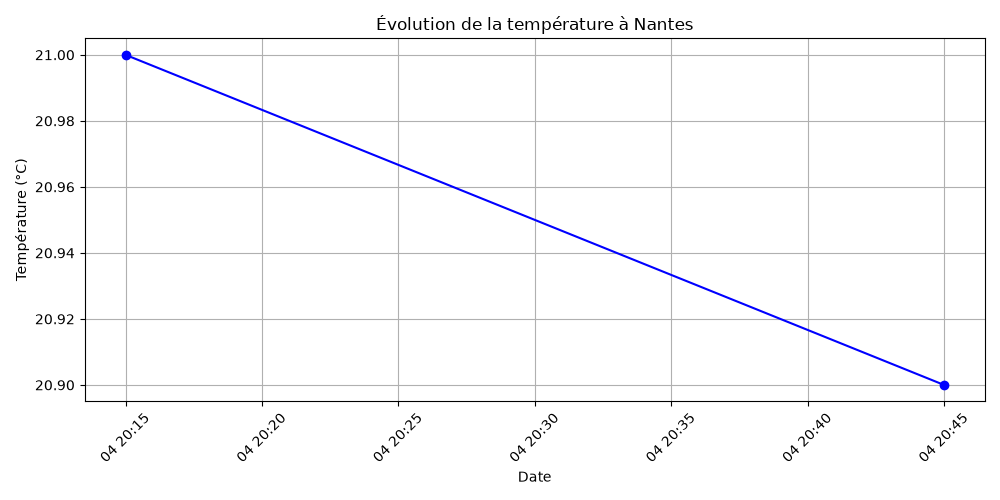

#  Pipeline ETL Météo Automatisé avec Airflow

Salut ! Je m'appelle Abbas, je suis en Master Data IA et je cherche une alternance en Data Engineering.

Ce projet, je l'ai fait pour **montrer concrètement** ce que je sais faire. Pas juste des mots sur un CV, mais du vrai code qui tourne de bout en bout.

---

## Le projet en 2 phrases

Je récupère la météo de Nantes en temps réel (via une API gratuite), je nettoie les données avec Pandas, je les stocke dans une base PostgreSQL (via Docker), et j'ai **automatisé tout ça avec Apache Airflow** pour que le pipeline tourne tout seul toutes les heures.

Rien de révolutionnaire, mais ça touche à tout ce qui est important pour un Data Engineer.

---

##  Ce que j'ai utilisé

- **Python** (requests, pandas, matplotlib) : pour le traitement et l'extraction.
- **PostgreSQL** : pour stocker les données.
- **Docker & Docker Compose** : pour lancer PostgreSQL *et* Airflow sans les installer sur ma machine.
- **Apache Airflow** : pour orchestrer le pipeline (l'exécuter automatiquement).
- **API Open-Meteo** : pour récupérer les données météo (gratuit, sans clé API).
- **Git** : pour le versionnement du code.

---

##  Comment ça marche concrètement ?

1. **Extraction** : Un script Python appelle l'API Open-Meteo.
2. **Transformation** : Les données sont nettoyées et structurées avec Pandas.
3. **Chargement** : Les données sont insérées dans PostgreSQL (qui tourne dans un conteneur Docker).
4. **Orchestration** : Un DAG Airflow (le fichier `meteo_dag.py`) planifie et exécute ce script toutes les heures. Airflow gère les erreurs et me donne un tableau de bord pour suivre l'état du pipeline.

J'ai aussi créé un petit dashboard avec Matplotlib pour visualiser l'évolution des températures.

---

## Aperçu du résultat

Voici le tableau de bord Airflow montrant le succès de l'exécution du pipeline :



---

##  Comment lancer le projet (si tu veux tester)

### 1. Lancer l'infrastructure avec Docker Compose
Cette commande va lancer la base de données PostgreSQL et le serveur Airflow en même temps :
```bash
docker compose up -d
